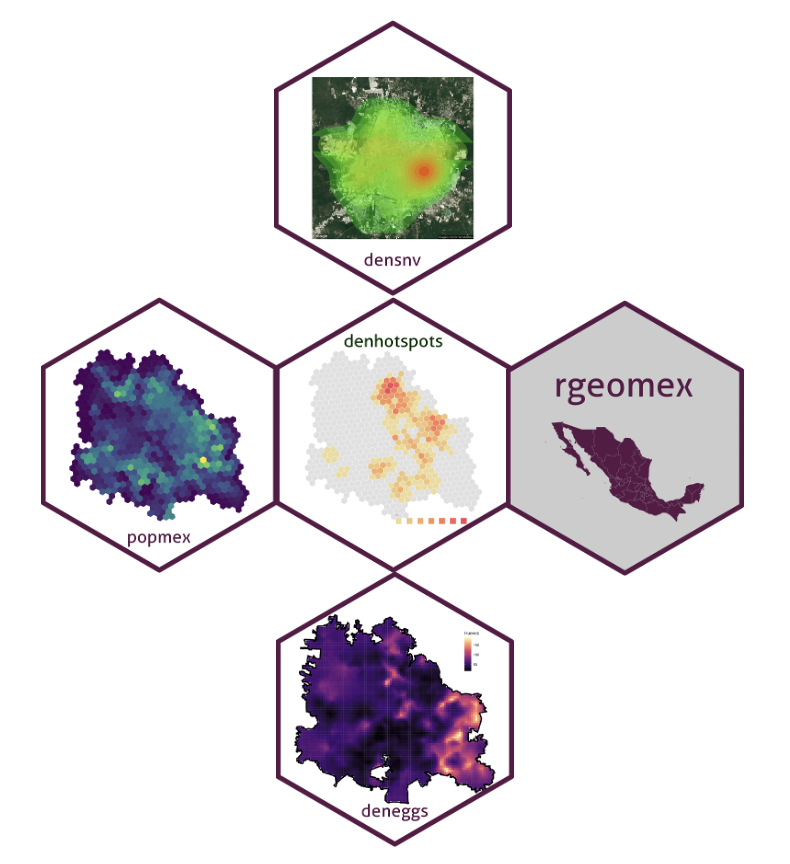
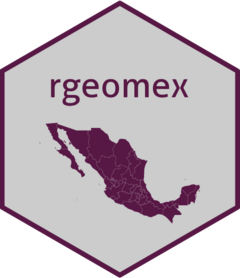
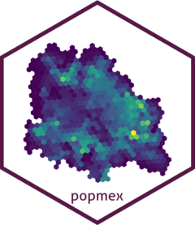
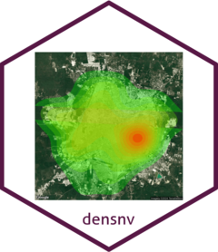
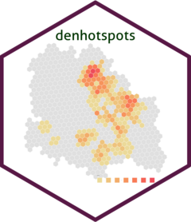
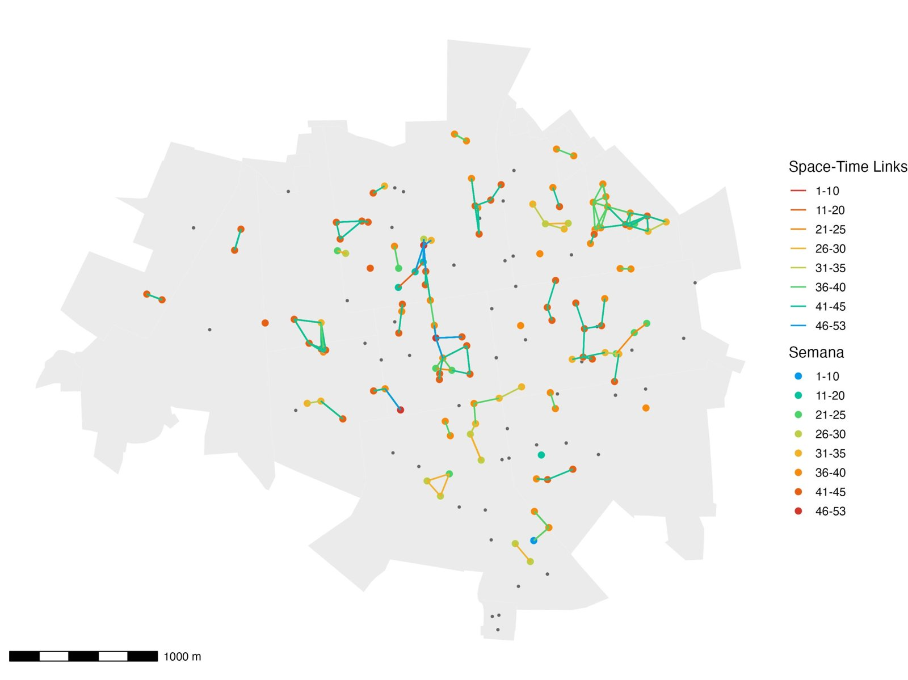
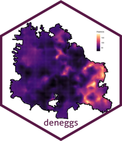

## Temario

:::: {.columns}
::: {.column width="50%"}
**El entorno de trabajo**

- Instalación de [R](https://www.r-project.org)
- Herramientas de compilación ([Rtools](https://cran.r-project.org/bin/windows/Rtools/) / Xcode)
- IDE: RStudio, Positron, VS Code, Antigravity
:::

::: {.column width="50%"}
**Los paquetes**

- Desde CRAN, GitHub, Bioconductor, r-universe y archivo local
- En Google Colab
- [CRAN Task Views](https://cran.r-project.org/web/views/)
- Metapaquetes, universos y *verses*
- El **dengueverse**: paquetes e instalación
:::
::::

## ¿Qué vamos a instalar?

```{mermaid}
%%| fig-width: 10
flowchart LR
  R["1 · R"] --> T["2 · Rtools (Windows)<br/>Xcode CLT (macOS)"]
  T --> I["3 · IDE<br/>RStudio u otro"]
  I --> P["4 · Paquetes<br/>CRAN · GitHub · r-universe"]
  P --> D["5 · dengueverse"]
  style D fill:#0b3d1e,color:#fff,stroke:#0b3d1e
```

::: {.nota}
El orden importa: sin las herramientas de compilación, los paquetes que se instalan desde GitHub o desde código fuente fallan.
:::

## Instalación de R

1. Ir a [cloud.r-project.org](https://cloud.r-project.org)
2. Elegir el sistema operativo: **Windows**, **macOS** o **Linux**
3. Descargar la versión más reciente (en macOS, elegir *Apple silicon* o *Intel* según el equipo)
4. Ejecutar el instalador con las opciones por defecto
5. Verificar la versión instalada:

```r
R.version.string
```

## Herramientas de compilación

::: {.panel-tabset}

### Windows

Instalar **[Rtools](https://cran.r-project.org/bin/windows/Rtools/)** en la versión que corresponda a tu R (por ejemplo, R 4.5.x → Rtools45).

```r
# Debe regresar TRUE
pkgbuild::has_build_tools(debug = TRUE)
```

### macOS

Instalar las *Command Line Tools* de Xcode desde la Terminal:

```bash
xcode-select --install
```

Algunos paquetes espaciales necesitan además [gfortran](https://cran.r-project.org/bin/macosx/tools/).

### Linux

```bash
sudo apt install r-base-dev libudunits2-dev libgdal-dev libgeos-dev libproj-dev
```

:::

## Entornos de desarrollo (IDE)

| IDE | Para qué sirve |
|------------------------------|-------------------------------------------|
| [RStudio](https://posit.co/download/rstudio-desktop/) | El IDE clásico para R; el que usaremos en el curso |
| [Positron](https://positron.posit.co/download.html) | Nuevo IDE de Posit para R y Python |
| [Visual Studio Code](https://code.visualstudio.com) | Editor general; requiere la extensión de R |
| [Antigravity](https://antigravity.google) | IDE de Google con agentes de IA integrados |
| [Google Colaboratory](https://colab.research.google.com) | R en el navegador, sin instalar nada |

::: {.nota}
Los paquetes los instala **R**, no el IDE: las mismas instrucciones `install.packages()`, `BiocManager::install()` y `pak::pkg_install()` funcionan igual en todos.
:::

## Instalación de RStudio

1. Ir a [posit.co/download/rstudio-desktop](https://posit.co/download/rstudio-desktop/)
2. Confirmar que R ya está instalado (paso 1)
3. Descargar *RStudio Desktop* para tu sistema operativo
4. Ejecutar el instalador
5. Abrir RStudio y revisar en la consola que aparezca la versión de R

::: {.nota}
Si tienes varias versiones de R: **Tools → Global Options → General → R version**.
:::

## Instalación de paquetes desde CRAN

::: {.panel-tabset}

### Un paquete

```r
install.packages("ggplot2")

# Verificamos la instalación
library(ggplot2)
```

### Varios paquetes

```r
install.packages(c("sf", "tmap", "ggspatial"))

library(sf)
```

### Solo los que faltan

```r
paquetes <- c("sf", "tmap", "ggspatial", "tidyverse")
faltan   <- paquetes[!paquetes %in% rownames(installed.packages())]
if (length(faltan)) install.packages(faltan)
```

:::

## Instalación de paquetes desde GitHub

::: {.panel-tabset}

### pak (recomendado)

```r
install.packages("pak")
pak::pkg_install("fdzul/rgeomex")
library(rgeomex)
```

`pak` resuelve dependencias del sistema y es más rápido.

### remotes

```r
install.packages("remotes")
remotes::install_github("fdzul/rgeomex")
```

### devtools

```r
install.packages("devtools")
devtools::install_github("fdzul/rgeomex")
```

### renv

```r
renv::install("fdzul/rgeomex")
```

Útil cuando el proyecto usa [renv](https://rstudio.github.io/renv/) para fijar versiones.

:::

## Instalación de paquetes desde Bioconductor

[Bioconductor](https://bioconductor.org) es un repositorio de paquetes para bioinformática y genómica (secuencias, filogenia, genética de poblaciones de vectores).

```r
# 1. Instalar el administrador de Bioconductor (desde CRAN)
install.packages("BiocManager")

# 2. Instalar uno o varios paquetes
BiocManager::install(c("Biostrings", "ggtree"))

# 3. Revisar la versión y que todo esté actualizado
BiocManager::version()
BiocManager::valid()
```

::: {.nota}
`pak` también instala desde Bioconductor: `pak::pkg_install("bioc::Biostrings")`.
:::

## Instalación desde r-universe

[r-universe](https://r-universe.dev) compila los paquetes de GitHub y los distribuye **ya compilados**, como si fuera CRAN: no se necesitan Rtools ni Xcode.

```r
install.packages("denhotspots",
                 repos = c("https://fdzul.r-universe.dev",
                           "https://cloud.r-project.org"))
```

::: {.nota}
Es la forma más sencilla de instalar el dengueverse en las computadoras del curso.
:::

## Instalación desde un archivo local

::: {.panel-tabset}

### Windows (.zip)

```r
install.packages("C:/Users/usuario/Downloads/ggplot2_3.5.2.zip",
                 repos = NULL, type = "win.binary")
```

### macOS / Linux (.tar.gz)

```r
install.packages("~/Downloads/gt_1.1.0.tar.gz",
                 repos = NULL, type = "source")
```

### Buscar el archivo

```r
# Abre una ventana para seleccionar el archivo
install.packages(file.choose(), repos = NULL)
```

:::

## Instalación de paquetes en Google Colab

En [Colab](https://colab.research.google.com): **Entorno de ejecución → Cambiar tipo de entorno → R**.

::: {.panel-tabset}

### CRAN

```r
install.packages(c("sf", "tmap"))
```

Si falta una librería del sistema (p. ej. para `sf`):

```r
system("apt-get install -y libudunits2-dev libgdal-dev libgeos-dev libproj-dev")
```

### Bioconductor

```r
install.packages("BiocManager")
BiocManager::install("Biostrings")
```

### GitHub

```r
install.packages("remotes")
remotes::install_github("fdzul/rgeomex")
```

### dengueverse

```r
install.packages("denhotspots",
                 repos = c("https://fdzul.r-universe.dev",
                           "https://cloud.r-project.org"))
```

:::

::: {.nota}
Colab corre en Linux: los paquetes de CRAN se compilan y pueden tardar varios minutos. Al cerrar la sesión **se pierden** y hay que reinstalarlos.
:::

## Instalación con CRAN Task Views

Las [Task Views](https://cran.r-project.org/web/views/) agrupan los paquetes de un tema.

```r
install.packages("ctv")

# Solo los paquetes principales del tema (más rápido)
ctv::install.views("Epidemiology", coreOnly = TRUE)

# Todos los paquetes del tema
ctv::install.views("Epidemiology")
```

## Desafío

Instalar los paquetes principales de tres Task Views:

::: {.panel-tabset}

### Spatial

```r
ctv::install.views("Spatial", coreOnly = TRUE)
```

[Ver la Task View](https://cran.r-project.org/web/views/Spatial.html)

### SpatioTemporal

```r
ctv::install.views("SpatioTemporal", coreOnly = TRUE)
```

[Ver la Task View](https://cran.r-project.org/web/views/SpatioTemporal.html)

### Epidemiology

```r
ctv::install.views("Epidemiology", coreOnly = TRUE)
```

[Ver la Task View](https://cran.r-project.org/web/views/Epidemiology.html)

:::

## Metapaquetes, universos y *verses*

- **Metapaquete**: un paquete que instala y carga otros paquetes (ej. `tidyverse`, `easystats`, `tidymodels`).
- **Universo**: un repositorio propio de paquetes en [r-universe](https://ropensci.org/r-universe/) (ej. [fdzul.r-universe.dev](https://fdzul.r-universe.dev)).
- **Verse**: una familia de paquetes con un objetivo común y un mismo estilo.
  - Ejemplos: **ETVerse**, **IVAverse** y **dengueverse**

## Universo de Vectores en R

```{mermaid}
%%| fig-width: 11
flowchart TB
  V[Vectores] --> ET[ETVerse] & IVA[IVAverse] & TR[transverse]
  ET --> DV[dengueverse] & CH[chagasverse] & LE[leisverse] & MA[malverse]
  IVA --> AL[alaverse] & AR[araverse]
  DV --> DH[denhotspots] & DE[deneggs] & DS[densnv] & BO[boldenr] & DC[dencontrol] & DK[denepikit]
  TR --> RG[rgeomex] & PO[popmex] & CL["climex (Python)"]
  classDef disp fill:#0b3d1e,color:#fff,stroke:#0b3d1e
  classDef dev fill:#fff,color:#555,stroke:#999,stroke-dasharray:4 3
  classDef gh fill:#fff,color:#0b3d1e,stroke:#0b3d1e,stroke-width:2px
  classDef grupo fill:#5a1846,color:#fff,stroke:#5a1846
  class DH,DE,DS,BO,RG,PO disp
  class DK,CL gh
  class DC dev
  class V,ET,IVA,TR,DV grupo
```

[**Verde:** en r-universe]{style="color:#0b3d1e"} · [**Borde verde:** en GitHub]{style="color:#0b3d1e"} · [**Punteado:** en desarrollo]{style="color:#777"}

## dengueverse

:::: {.columns}
::: {.column width="45%"}
{width="400"}
:::

::: {.column width="55%"}
El **dengueverse** es un universo de paquetes de R para el análisis y la toma de decisiones en el Programa de Prevención y Control del Dengue en México.

| Paquete | Para qué |
|---------|----------|
| rgeomex | Cartografía (INEGI / INE) |
| popmex | Población |
| densnv · boldenr | Bases del SINAVE |
| denhotspots | Hotspots y transmisión activa |
| deneggs | Ovitrampas y vector |
:::
::::

## [rgeomex](https://fdzul.github.io/rgeomex/)

:::: {.columns}
::: {.column width="30%"}
[{width="230"}](https://fdzul.github.io/rgeomex/)
:::

::: {.column width="70%"}
Bases de datos geográficas del INEGI y del INE a distintas resoluciones: estatal (AGEE), municipal (AGEM), localidades, sectores, AGEB y manzanas.

**Funciones clave:** `extract_locality()` · `extract_ageb()` · `extract_blocks()` · `extract_sectores()`
:::
::::

## [popmex](https://fdzul.github.io/popmex/)

:::: {.columns}
::: {.column width="30%"}
[{width="230"}](https://fdzul.github.io/popmex/)
:::

::: {.column width="70%"}
Bases de datos de población de México a nivel municipal y en hexágonos:

- Proyecciones de CONAPO y censos 2000, 2010 y 2020
- Densidad de población HDX 2021–2023 (400 m de resolución)

**Funciones clave:** `extract_pop()` · `get_landscan()`
:::
::::

## [densnv & boldenr](https://fdzul.github.io/densnv/)

:::: {.columns}
::: {.column width="30%"}
[{width="230"}](https://fdzul.github.io/densnv/)
:::

::: {.column width="70%"}
Análisis de las bases de las Enfermedades Transmitidas por Vector del SINAVE mediante gráficas, tablas y mapas, para apoyar decisiones racionales y oportunas en los programas de ETV. **boldenr** genera los productos del boletín de dengue (canales endémicos, mapas de calor, serotipos).

**Funciones clave:** `read_dengue_dataset()` · `cases_week()` · `mp_heatmap()` · `epidemiological_channel()`
:::
::::

## [denhotspots](https://fdzul.github.io/denhotspots/)

:::: {.columns}
::: {.column width="30%"}
[{width="230"}](https://fdzul.github.io/denhotspots/)
:::

::: {.column width="70%"}
Análisis espacial del dengue con el estadístico local G<sub>i</sub><sup>*</sup> (hotspots de transmisión persistente) y análisis espacio-temporal de la transmisión activa: prueba de Knox, cadenas de transmisión y modelo Log-Gaussian Cox Process.

**Funciones clave:** `gihi()` · `knox()` · `transmission_chains_map()` · `spatial_lgcp()` · `risk_ageb()`
:::
::::

## denhotspots: cadenas de transmisión

{fig-align="center" height="420"}

[Casos de dengue vinculados en espacio y tiempo, coloreados por semana epidemiológica.]{.pequeno}

## [deneggs](https://fdzul.github.io/deneggs/)

:::: {.columns}
::: {.column width="30%"}
[{width="230"}](https://fdzul.github.io/deneggs/)
:::

::: {.column width="70%"}
Genera mapas predictivos del número de huevos de *Aedes aegypti* en las áreas donde no se colocan ovitrampas, mediante análisis geoestadístico con SPDE-INLA, e identifica los hotspots del vector.

**Funciones clave:** `ovitraps_read()` · `spde_inla()` · `eggs_map()` · `eggs_hotspots()`
:::
::::

## Instalación del dengueverse

Una sola instrucción instala los paquetes del dengueverse **y sus dependencias que no están en CRAN** (`knox`, `ppmData`), ya compiladas:

```r
install.packages(c("rgeomex", "denhotspots", "densnv", "boldenr", "popmex"),
                 repos = c("https://fdzul.r-universe.dev",
                           "https://cloud.r-project.org"))
```

::: {.nota}
Desde GitHub (requiere Rtools/Xcode): `pak::pkg_install("fdzul/denepikit")`. [climex](https://github.com/fdzul/climex) es un paquete de Python: `pip install climex`.
:::

## deneggs e INLA

[deneggs](https://fdzul.github.io/deneggs/) requiere [INLA](https://www.r-inla.org), que no está en CRAN, y `similiars`, que se instala desde r-universe:

```r
install.packages("INLA",
                 repos = c(getOption("repos"),
                           INLA = "https://inla.r-inla-download.org/R/stable"),
                 dep = TRUE)

install.packages("deneggs",
                 repos = c("https://fdzul.r-universe.dev",
                           "https://cloud.r-project.org"))
```

## SaTScan

Para el análisis de conglomerados espacio-temporales:

1. Descargar e instalar el programa [SaTScan](https://www.satscan.org) (gratuito)
2. Instalar el paquete de R que lo conecta:

```r
install.packages("rsatscan")
```

## Verificar la instalación

```r
paquetes <- c("sf", "tmap", "INLA", "rgeomex", "denhotspots",
              "deneggs", "densnv", "boldenr")

data.frame(paquete   = paquetes,
           instalado = vapply(paquetes, requireNamespace,
                              logical(1), quietly = TRUE))
```

Si alguno sale `FALSE`, revisar la siguiente diapositiva.

## Problemas comunes

| Mensaje o síntoma | Causa probable | Solución |
|---------------------------|-------------------------|---------------------------------|
| `non-zero exit status` | Faltan herramientas de compilación | Instalar Rtools / Xcode CLT, o usar r-universe |
| `Permission denied` / `lib is not writable` | Sin permisos en la carpeta de R | Aceptar la librería personal que propone R |
| `API rate limit exceeded` | Demasiadas descargas desde GitHub | Usar r-universe o configurar un `GITHUB_PAT` |
| No descarga nada en la red institucional | Proxy o firewall | Probar con otra red o pedir acceso a soporte |
| `package ... is not available` | Nombre mal escrito o no está en CRAN | Revisar el nombre y el repositorio |

## Contacto

- **Bio**: <https://fdzul.github.io/web_site_fadm/>
- **Correo**: <felipe.dzul.m@gmail.com>
- **Celular**: 999 958 0167
- **GitHub**: <https://github.com/fdzul>
- **dengueverse**: <https://fdzul.r-universe.dev>
- **Presentación**: <https://polite-treacle-c5a008.netlify.app/talks/pkg_installation/#/>
