```{r setup}
#| include: false
# Las diapositivas con datos del SINAVE solo se ejecutan si existen los archivos
# en esta computadora; si no, se muestra el código y una nota.
ruta_casos   <- "~/Documents/geocoding_mx_2026_dengue/4.RData/dengue_mx_2026.RData"
ruta_ovi     <- "/Users/fdzul/Library/CloudStorage/Dropbox/CENAPRECE/2026/31_yucatan"
ruta_sinave  <- "/Users/fdzul/Library/CloudStorage/OneDrive-Personal/proyects/geocoding_mex/2024/1.data/current_week/DENGUE2_.txt"
ruta_geo2024 <- "~/Documents/geocoding_mx_2026_dengue/4.RData/dengue_mx_2026.RData"
hay_casos   <- file.exists(path.expand(ruta_casos))
hay_ovi     <- file.exists(ruta_ovi)
hay_sinave  <- file.exists(ruta_sinave)
hay_geo2024 <- file.exists(ruta_geo2024)
sin_datos <- function() knitr::asis_output(
  "::: {.nota}\nEste mapa interactivo se genera con la base geocodificada del SINAVE, que no se incluye en la presentación.\n:::\n")

# Datos simulados para los ejemplos de leaflet, mapview y mapgl
set.seed(2026)
n <- 300
casos_sim <- sf::st_as_sf(
  data.frame(id = 1:n,
             semana = sample(1:43, n, replace = TRUE),
             lon = rnorm(n, -96.725, 0.02),
             lat = rnorm(n, 17.065, 0.015)),
  coords = c("lon", "lat"), crs = 4326)

mapview::mapviewOptions(basemaps = c("Esri.WorldGrayCanvas","Stadia.AlidadeSmoothDark","OpenStreetMap", "Esri.WorldImagery", "OpenTopoMap"))
```

## Temario

:::: {.columns}
::: {.column width="50%"}
- Datos espaciales
- Tipos de mapas
- Mapas estáticos en R
  - Base R · ggplot2 · tmap · mapsf
:::

::: {.column width="50%"}
- Mapas interactivos en R
  - **leaflet · mapview · mapgl**
  - Diferencias, peso y mapas por dashboard
- Mapas animados
- Mapas en 3D ([rayshader](https://www.rayshader.com))
:::
::::

## Clasificación de los datos espaciales

```{mermaid}
%%| fig-width: 11
flowchart TB
  SD[Datos espaciales] --> C[Continuo] & D[Discreto]
  C --> F[Fijo] & A[Aleatorio]
  D --> R[Regular] & I[Irregular]
  F --> GD[Datos geoestadísticos] --> OV[Ovitrampas]
  A --> PP[Patrón de puntos] --> CA[Casos]
  I --> AR[Datos de área] --> AG[Casos por colonia / AGEB]
  R --> LA[Datos de rejilla] --> GR[Casos por celda]
  classDef raiz fill:#0b3d1e,color:#fff,stroke:#0b3d1e
  classDef tipo fill:#5a1846,color:#fff,stroke:#5a1846
  classDef ej fill:#fbf7f0,color:#333,stroke:#bc955c
  class SD,C,D,F,A,R,I raiz
  class GD,PP,AR,LA tipo
  class OV,CA,AG,GR ej
```

::: aside
[Krainski et al. 2019](https://becarioprecario.bitbucket.io/spde-gitbook/)
:::

## Tipos de mapas

| Estáticos | Interactivos | Animados | 3D |
|-----------|--------------|----------|----|
| Base R | **leaflet** | tmap | rayshader |
| ggplot2 · ggspatial | **mapview** | gganimate | |
| tmap | **mapgl** | | |
| mapsf | tmap · plotly | | |

::: {.nota}
Los cuatro tipos sirven para los tres tipos de datos: patrón de puntos, geoestadísticos y de área.
:::

## Datos espaciales

::: {.panel-tabset}

### Patrón de puntos

```{r point_pattern_data}
#| eval: !expr hay_casos
load(ruta_casos)
gua <- rgeomex::extract_locality(locality = c("Guadalajara", 
                                              "Tlaquepaque",
                                              "Zapopan", 
                                              "Tonalá"),
                                 cve_edo = "14")
z <- z |>
  dplyr::filter(ESTATUS_CASO %in% c(2)) |>
  sf::st_as_sf(coords = c("long", "lat"), 
               crs = 4326)
z_cases <- z[gua, ]

mapview::mapview(z_cases, 
                 layer.name = "Semana", 
                 zcol = "SEM")


```

```{r}
#| eval: !expr "!hay_casos"
sin_datos()
```

### Datos geoestadísticos

```{r geostatistical_data}
#| eval: !expr hay_ovi
path_vect <- "/Users/fdzul/Library/CloudStorage/Dropbox/CENAPRECE/2026/31_yucatan"
path_coord <- paste0(path_vect, "/DescargaOvisActivas.csv")

# Paso 2. definir el resto de argumentos y aplicar la función
mapview::mapviewOptions(basemaps = c("Esri.WorldGrayCanvas",
                                     "Stadia.AlidadeSmoothDark",
                                     "OpenStreetMap", 
                                     "Esri.WorldImagery", 
                                     "OpenTopoMap"))
deneggs::eggs_risk(path_vect = path_vect,
                   path_coord = path_coord,
                   weeks = 30,
                   locality = "Ticul",
                   risk = FALSE)
```

```{r}
#| eval: !expr "!hay_ovi"
sin_datos()

```

### Datos de área

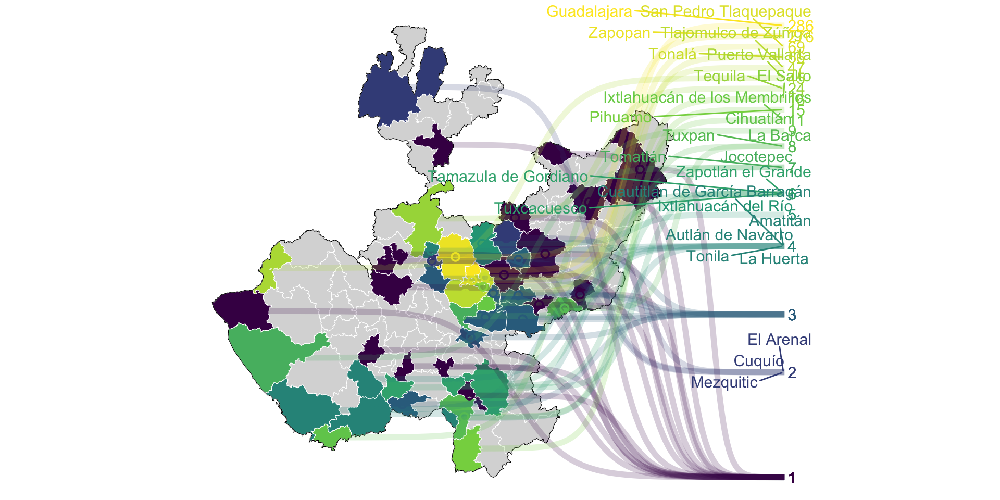{fig-align="center" height="440"}

:::

## Datos de área irregulares

::: {.panel-tabset}

### Triangulación de Delaunay

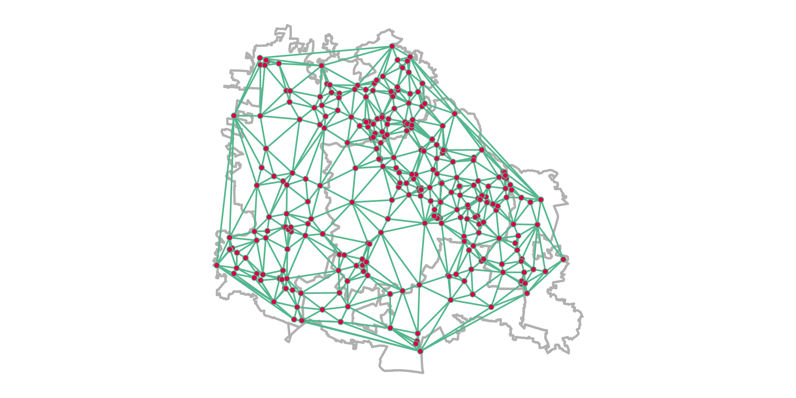{fig-align="center" height="440"}

### Teselación de Dirichlet (Voronoi)

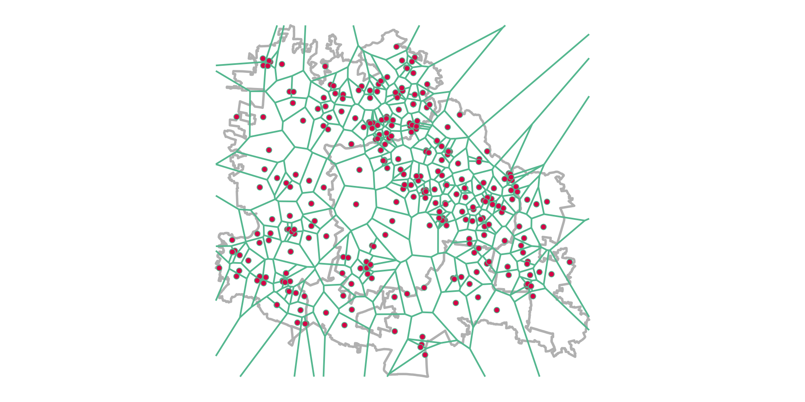{fig-align="center" height="440"}

### Código

```{.r}
voronoi <- deldir::deldir(x = z_cases$lon, y = z_cases$lat,
                          rw = c(bb_box[1], bb_box[3], bb_box[2], bb_box[4]))
ggplot2::ggplot() +
  ggplot2::geom_sf(data = gua, linewidth = 1, fill = NA, col = "gray") +
  ggplot2::geom_segment(ggplot2::aes(x = x1, y = y1, xend = x2, yend = y2),
                        data = voronoi$delsgs,   # voronoi$dirsgs para Dirichlet
                        linewidth = .7, color = "#63C1A0") +
  ggplot2::geom_sf(data = z_cases, col = "#63C1A0", fill = "#E01A59",
                   pch = 21, size = 2) +
  cowplot::theme_map()
```

:::

## Datos de área regulares

::: {.panel-tabset}

### Rejilla cuadrada

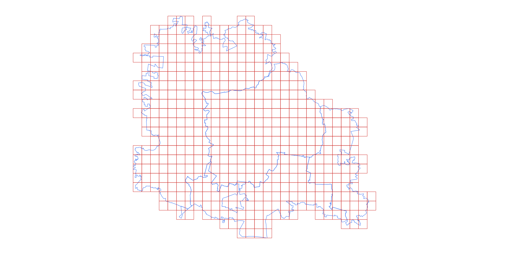{fig-align="center" height="440"}

### Rejilla hexagonal

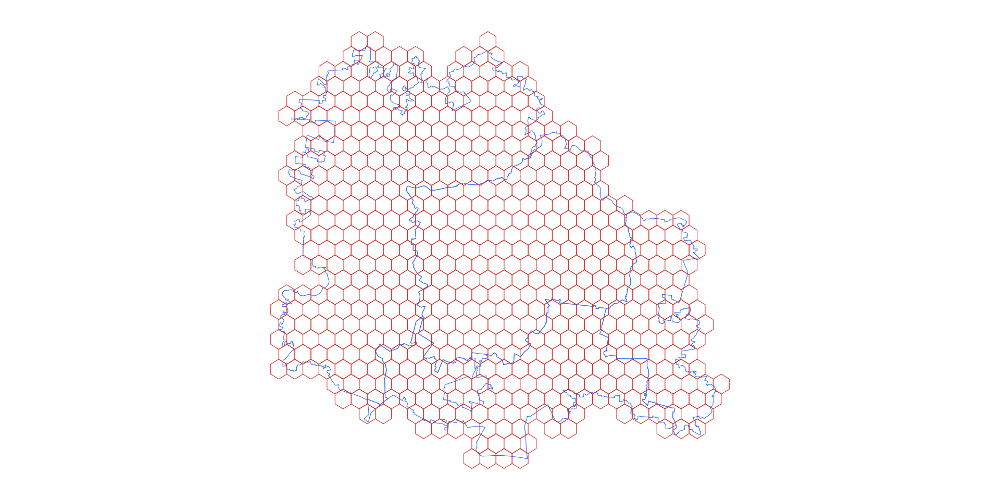{fig-align="center" height="440"}

### Código

```{.r}
loc <- rgeomex::extract_ageb(locality = c("Guadalajara", "Zapopan",
                                          "Tlaquepaque", "Tonalá"),
                             cve_edo = "14")
# square = FALSE para la rejilla hexagonal
grid <- sf::st_make_grid(x = loc$locality, square = TRUE, cellsize = 0.01)
grid <- grid[loc$locality]

ggplot2::ggplot() +
  ggplot2::geom_sf(data = loc$locality, fill = NA, col = "#4285F4") +
  ggplot2::geom_sf(data = grid, fill = NA, col = "#DB4437") +
  cowplot::theme_map()
```

:::

## Mapas estáticos

::: {.panel-tabset}

### Base R

:::: {.columns}
::: {.column width="45%"}
```{.r}
library(sf)
x <- rgeomex::AGEM_inegi19_mx |>
  dplyr::filter(CVE_ENT %in% "30") |>
  dplyr::mutate(casos = rpois(dplyr::n(), 4))

plot(x["casos"], key.pos = 4,
     axes = TRUE, graticule = TRUE)
```
:::
::: {.column width="55%"}
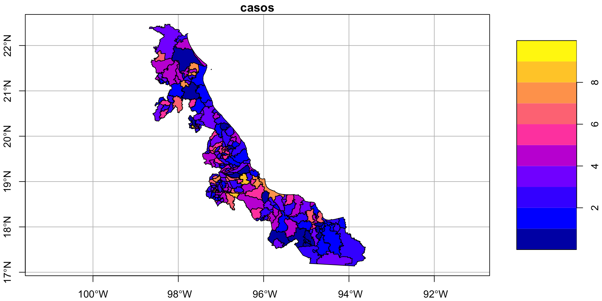
:::
::::

### ggplot2

:::: {.columns}
::: {.column width="45%"}
```{.r}
ggplot2::ggplot() +
  ggplot2::geom_sf(data = x,
    ggplot2::aes(fill = casos)) +
  fishualize::scale_fill_fish() +
  ggspatial::annotation_scale(
    location = "bl") +
  ggspatial::annotation_north_arrow(
    location = "tr")
```
:::
::: {.column width="55%"}
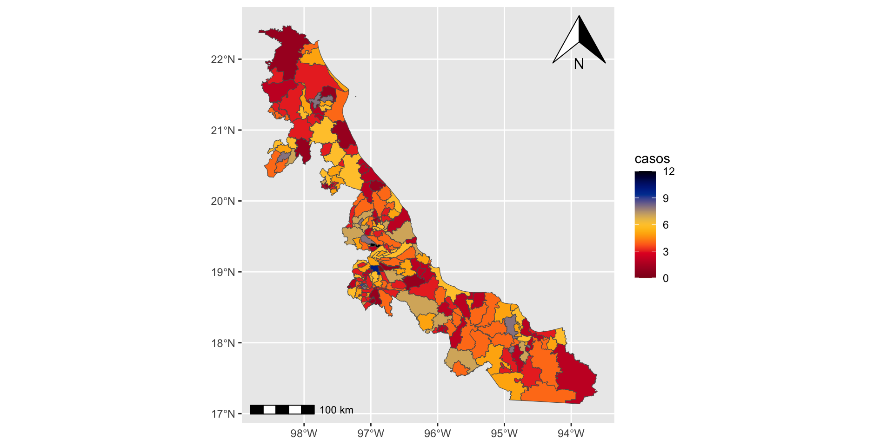
:::
::::

### tmap

:::: {.columns}
::: {.column width="45%"}
```{.r}
# tmap 4
library(tmap)
tm_shape(x) +
  tm_polygons(fill = "casos") +
  tm_compass(position = c("left", "top")) +
  tm_scalebar(position = c("left", "bottom"))
```
:::
::: {.column width="55%"}
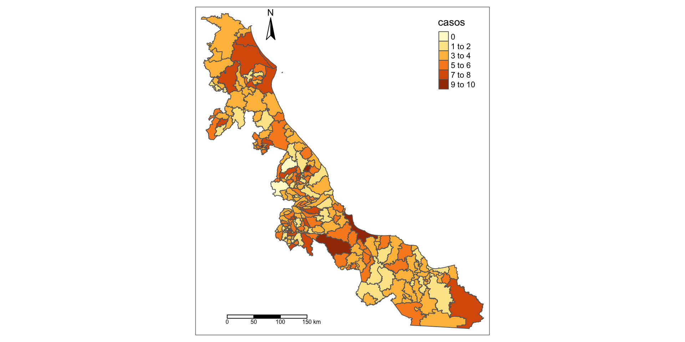
:::
::::

:::

## Mapas interactivos: tres opciones

| | **leaflet** | **mapview** | **mapgl** |
|---|---|---|---|
| Motor | Leaflet.js (SVG/Canvas) | leaflet + leafem + leafpop | MapLibre / Mapbox GL (WebGL) |
| Sintaxis | Capas encadenadas, control total | Una línea: `mapview(x)` | Capas estilo Mapbox: `add_*_layer()` |
| Fuerte en | Mapas a la medida | Explorar datos rápido | Muchos datos, 3D, estilos vectoriales |
| Débil en | > 10 mil elementos | Popups pesan mucho | Máx. ≈ 16 mapas por página |
| Ideal para | Dashboards y reportes | Análisis exploratorio | Mapas grandes y fluidos |

## leaflet

:::: {.columns}
::: {.column width="45%"}
```{.r}
pal <- leaflet::colorNumeric(
  "viridis", casos_sim$semana)

leaflet::leaflet(casos_sim) |>
  leaflet::addProviderTiles(
    "CartoDB.Positron") |>
  leaflet::addCircleMarkers(
    radius = 4, 
    stroke = FALSE,
    fillOpacity = .8,
    color = ~pal(semana)) |>
  leaflet::addLegend(
    pal = pal, 
    values = ~semana,
    title = "Semana")
```
:::
::: {.column width="55%"}
```{r leaflet_demo}
pal <- leaflet::colorNumeric("viridis", casos_sim$semana)
leaflet::leaflet(casos_sim, width = "100%", height = 460) |>
  leaflet::addProviderTiles("Esri.WorldImagery") |>
  leaflet::setView(lng = -96.725, lat = 17.065, zoom = 12) |>
  leaflet::addCircleMarkers(radius = 4, stroke = FALSE, fillOpacity = .8,
                            color = ~pal(semana)) |>
  leaflet::addLegend(pal = pal, values = ~semana, title = "Semana")
```
:::
::::

## mapview

:::: {.columns}
::: {.column width="45%"}
```{.r}
mapview::mapview(
  casos_sim,
  zcol = "semana",
  layer.name = "Semana")
```

Una línea agrega mapas base, leyenda, coordenadas del cursor, botón de zoom a la capa y una **tabla emergente** por cada punto.
:::
::: {.column width="55%"}
```{r mapview_demo}
m <- mapview::mapview(casos_sim, zcol = "semana", layer.name = "Semana")
m@map$height <- 460; m@map$width <- "100%"
m@map |> leaflet::setView(lng = -96.725, lat = 17.065, zoom = 12)
```
:::
::::

## mapgl

:::: {.columns}
::: {.column width="45%"}
```{.r}
library(mapgl)
maplibre(style = carto_style("positron"),
         bounds = casos_sim) |>
  add_circle_layer(
    id = "casos", source = casos_sim,
    circle_radius = 5,
    circle_color = interpolate(
      column = "semana",
      values = c(1, 43),
      stops = c("#440154", "#fde725")),
    tooltip = "semana") |>
  add_legend("Semana", values = c(1, 43),
    colors = c("#440154", "#fde725"))
```
:::
::: {.column width="55%"}
```{r mapgl_demo}
library(mapgl)
maplibre(style = carto_style("positron"), 
         bounds = casos_sim, width = "100%", 
         height = "460px") |>
  add_circle_layer(id = "casos", 
                   source = casos_sim, 
                   circle_radius = 5,
                   circle_color = interpolate(column = "semana", values = c(1, 43),
                                              stops = c("#440154", "#fde725")),
                   tooltip = "semana") |>
  add_legend("Semana", values = c(1, 43), colors = c("#440154", "#fde725"))
```
:::
::::

## ¿Cuánto pesa cada mapa?

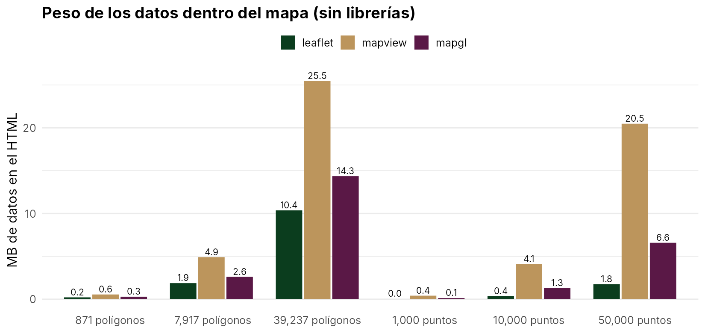{fig-align="center" height="400"}

[Mismos datos simulados guardados con `htmlwidgets::saveWidget()`. Script: `R_scripts/benchmark_pesos.R`.]{.pequeno}

## El peso tiene dos partes

**1. Librerías**: se descargan una vez por página, aunque haya varios mapas

| leaflet | mapview | mapgl |
|---|---|---|
| ≈ 2.2 MB | ≈ 2.2 MB | ≈ 13.7 MB |

**2. Datos**: se repiten en **cada** mapa

- **leaflet**: solo lo que tú agregas → el más ligero
- **mapview**: los *popups* con la tabla de atributos son la mayor parte. Con 50 mil puntos: **20.5 MB** → **2.9 MB** con `popup = FALSE`
- **mapgl**: GeoJSON con todos los atributos; pesa más que leaflet pero **dibuja mucho más rápido** (GPU)

[mapgl 0.5.3 (desarrollo); puede variar entre versiones.]{.pequeno}

## ¿Cuántos mapas caben en un dashboard?

:::: {.columns}
::: {.column width="50%"}
**leaflet y mapview**

- Sin límite técnico: 20 mapas en una página funcionaron
- El límite real es el **peso**: cada mapa trae sus propios datos
:::

::: {.column width="50%"}
**mapgl**

- Cada mapa usa un **contexto WebGL** de la tarjeta gráfica
- Chrome permite **≈ 16 activos**: con 20 mapas, los 4 primeros se quedaron en blanco
- Cuentan todos los mapas de la página, aunque estén en otra pestaña del dashboard
:::
::::

[Chrome: *Too many active WebGL contexts. Oldest context will be lost.*]{.pequeno}

## ¿Cuál usar?

| Situación | Recomendación |
|-----------------------------|------------------------------------|
| Revisar rápido una capa | `mapview(x)` |
| Dashboard con varios mapas pequeños | **leaflet** (o mapview con `popup = FALSE`) |
| Decenas de miles de puntos o manzanas | **mapgl** |
| Comparar dos semanas lado a lado | `mapgl::compare()` |
| Muchos mapas de mapgl | Un solo mapa con capas y `add_layers_control()` en lugar de muchos mapas |
| Archivo para enviar por correo | **leaflet**: el más ligero |

## Mapa estático vs interactivo

::: {.panel-tabset}

### Mapa estático

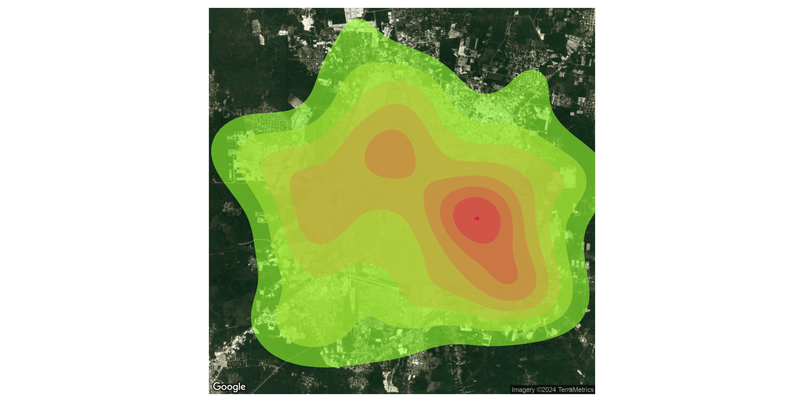{fig-align="center" height="440"}

### Mapa interactivo

```{r mapa_interactivo}
#| eval: !expr hay_geo2024
load(ruta_geo2024)
densnv::mp_heatmap(geocoded_dataset = z, 
                   cve_edo = "31",
                   locality = c("Mérida"), 
                   status_caso = c(1, 2),
                   week = 1:53, 
                  kernel = 80,
                   alpha = 0.6, 
                   static = FALSE,
                   palette = viridis::turbo,
                  save = FALSE)
```

```{r}
#| eval: !expr "!hay_geo2024"
sin_datos()
```

### Código

```{.r}
densnv::mp_heatmap(geocoded_dataset = z, 
                   cve_edo = "31",
                   locality = c("Mérida"), 
                   status_caso = c(1, 2),
                   week = 1:53, 
                  kernel = 0,
                   alpha = 0.6, 
                   static = FALSE,
                   palette = viridis::turbo,
                  save = FALSE)
```

:::

## Mapas animados

:::: {.columns}
::: {.column width="55%"}
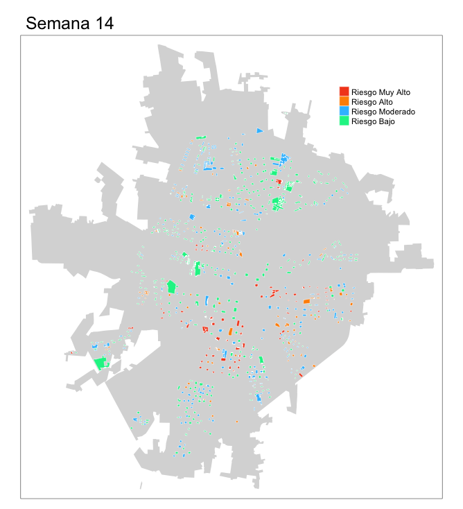{height="480"}
:::

::: {.column width="45%"}
Hotspots semanales del vector en Mérida con **deneggs**:

```{.r}
deneggs::animap_vector_hotblocks(
  path_vector = path_vector,
  cve_edo = "31",
  locality = "Merida",
  dir = "talks/spatial_data",
  name = "merida_2023",
  vel = 50,
  xleg = .75, yleg = .8)
```

[Código completo: `R_scripts/animated_maps_deneggs.R`]{.pequeno}
:::
::::

## Contacto

- **Bio**: <https://fdzul.github.io/web_site_fadm/>
- **Correo**: <felipe.dzul.m@gmail.com>
- **GitHub**: <https://github.com/fdzul>
- **dengueverse**: <https://fdzul.r-universe.dev>
- **Presentación**: <https://calm-hummingbird-41cb33.netlify.app/talks/spatial_data/>
